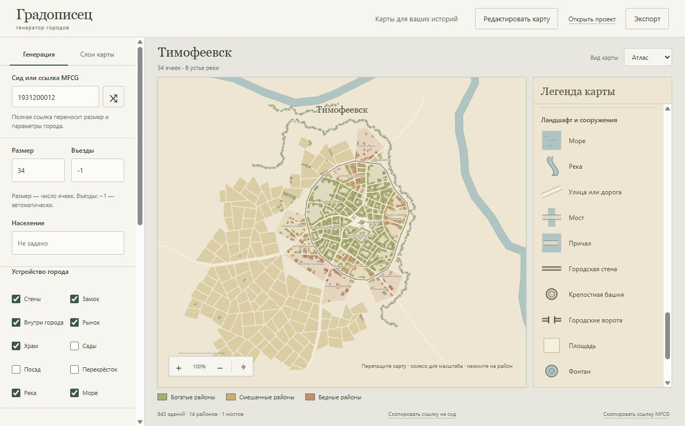
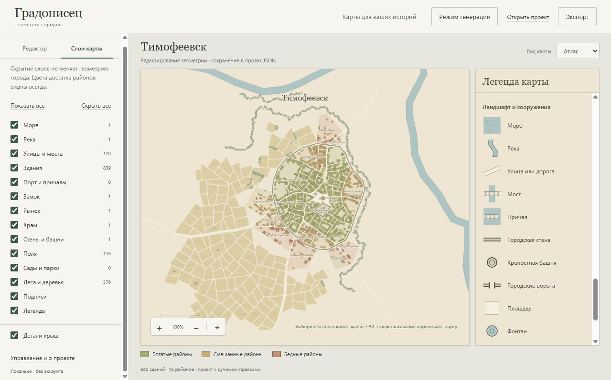
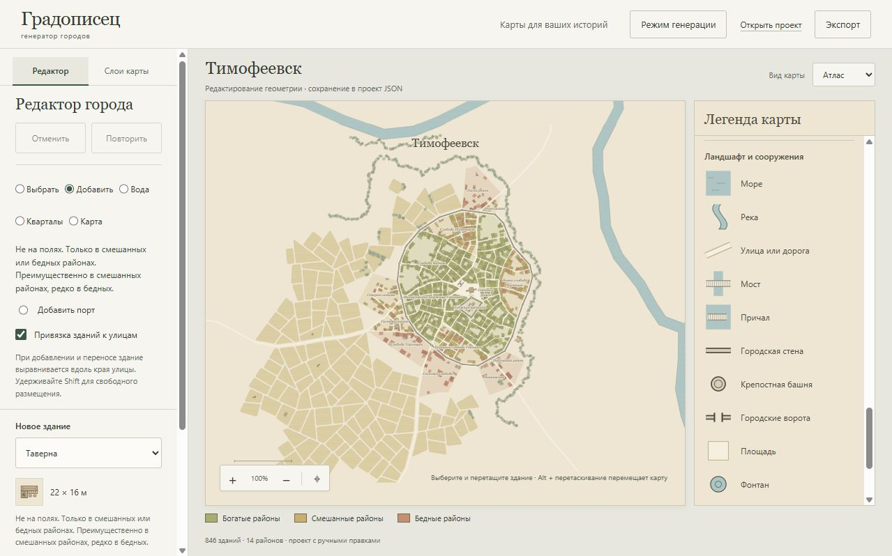
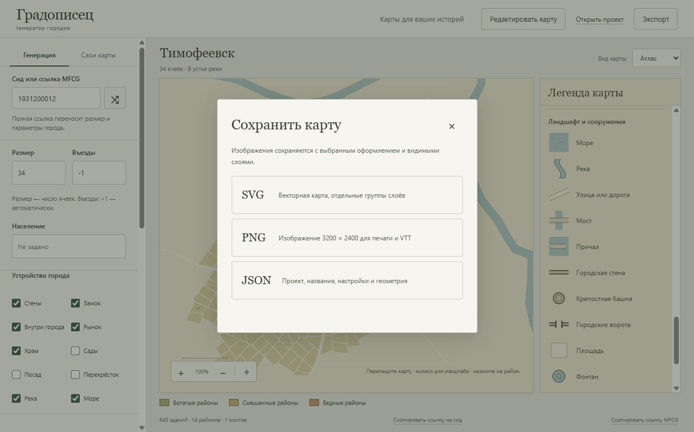

# Градописарь

Градописарь создаёт карты вымышленных городов для настольных ролевых игр, писательских миров и подготовки приключений.
Задайте размер, добавьте реку, море или крепостные стены, а затем обживите город: назовите улицы, поставьте таверну у
дороги, передвиньте квартал или измените берег.

Это русскоязычный аналог [Medieval Fantasy City Generator от watabou](https://watabou.github.io/city-generator/) (MFCG).



*Тимофеевск: город у воды с крепостной стеной, замком и полями за городской чертой. Все скриншоты в руководстве сняты в
работающем приложении через browser-use, без указателя мыши.*

## Что можно сделать

- **Подготовить место для приключения.** Получить город с домами, улицами, мостами, рынками, храмами и замком, с полями
  и лесами вокруг.
- **Выбрать характер поселения.** Построить город на суше, у реки, на морском берегу или в устье; включить посад, сады и
  укрепления.
- **Добавить места, нужные вашей истории.** Настроить количество таверн, мастерских, школ и других зданий при генерации
  или разместить их вручную. Есть и фэнтезийные объекты, например школа и башня магии.
- **Доработать планировку.** Перемещать и поворачивать здания, менять кварталы, русла рек и морские берега.
- **Подписать карту по-своему.** Переименовать город, районы, улицы и замок. Изначально они получают русские названия
  автоматически.
- **Забрать результат.** Сохранить картинку для игры или печати, вектор для дальнейшего оформления и проект для
  продолжения работы.

Приложение работает локально в браузере, без аккаунта. Генерация выполняется на вашем компьютере; после установки
зависимостей для работы интернет не нужен. Интерфейс пока только на русском.

## Как запустить

Понадобятся **Node.js 22 или новее** и npm. Откройте терминал в папке проекта и выполните:

```sh
npm ci
npm run dev
```

`npm ci` устанавливает зависимости перед первым запуском. В следующие разы достаточно `npm run dev`.

Откройте [Градописарь в браузере](http://127.0.0.1:4173). Первую карту приложение построит само. Терминал оставьте
открытым, пока работаете; для остановки сервера нажмите `Ctrl+C`. Этот сервер доступен только на вашем компьютере.

Двойной щелчок по `index.html` не заменяет запуск: приложению нужен локальный HTTP-сервер.

## Ваш первый город

1. Откройте вкладку **«Генерация»** слева. В узком окне сначала нажмите **«Настройки»** над картой.
2. Выберите **размер**. Для первого знакомства можно оставить `34`. Это количество ячеек основы карты, а не домов или
   жителей; допустимы значения от `6` до `200`.
3. Отметьте, что должно быть в городе: **«Стены»**, **«Замок»**, **«Рынок»**, **«Храм»**, **«Сады»** и другие объекты.
   Река и море включаются независимо друг от друга.
4. Нажмите **«Построить по сиду»**, чтобы применить настройки, или **«Новый город»**, чтобы получить другой вариант с
   новым сидом. Кнопки находятся ниже по панели: при необходимости прокрутите её.
5. Приблизьте интересное место колесом мыши. Перетаскивайте карту, чтобы рассмотреть окрестности, а кнопкой **«Показать
   всю карту»** верните общий вид.

Например, для небольшого поселения у реки отключите море и замок, оставьте реку и рынок. Для портового города включите
море, а для города в устье оставьте и море, и реку. После изменения переключателей снова постройте карту.

### Что такое сид

Сид задаёт исходную случайность: **одинаковый сид с одинаковыми настройками воспроизводит город в той же версии
приложения**. В поле **«Сид или ссылка MFCG»** можно ввести положительное целое число или вставить полную ссылку на
город MFCG. Ссылка переносит основные параметры, включая размер, поэтому удобнее одного числа, если вы хотите повторить
настройку города.

Кнопка со случайным сидом рядом с полем помогает выбрать другое число. **«Новый город»** сразу строит новый вариант.

### Как настроить город подробнее

**Въезды.** Значение `-1` оставляет выбор количества генератору. Если нужно своё количество, задайте его числом.

**Население.** Это отдельный параметр, а не результат подсчёта домов. Он влияет на выбор названия поселения: для хутора
и большого города используются разные словари. Поле можно оставить пустым.

**Рынки и храмы.** Ползунки задают их количество. Максимум растёт с размером города, каждый объект занимает отдельный
квартал. Чтобы отключить их, снимите соответствующий переключатель.

**Кастомные объекты.** Раскройте этот раздел, чтобы настроить количество зданий каждого типа. По умолчанию количества
рассчитываются по размеру города; ручное изменение ползунка задаёт ваше значение. **«Рассчитать по размеру»** возвращает
автоматический подбор. Если подходящих мест не хватит, приложение сообщит, сколько объектов удалось разместить. В
категории «Постой и питание» всегда остаётся хотя бы один объект.

**Форма воды.** Направление морского берега настраивается в разделе «Море». В разделе **«Дополнительно: форма воды»**
можно менять ширину и извилистость реки, сдвигать берег. Эти настройки сохраняются в собственной ссылке Градописаря.

## Как читать и оформлять карту

Слева находятся настройки, в центре карта, справа легенда с рисунками объектов. Легенда объясняет условные обозначения
всех типов, включая те, которых может не быть в конкретном городе. Цвета помогают различать богатые, смешанные и бедные
районы.

Нажмите на район, чтобы узнать его название, достаток, количество зданий и площадь. В открывшейся панели можно изменить
название. Так же можно выбрать улицу или замок; название самого города редактируется прямо над картой.

Во вкладке **«Слои карты»** можно скрывать дома, воду, улицы, стены, растительность и подписи. Это меняет отображение,
сохраняя планировку. Здесь же отключаются легенда и детали крыш. Меню **«Вид карты»** над картой переключает оформление:
цветной **«Атлас»** или более сдержанную **«Тушь»**.



*Слои пригодятся и перед экспортом: на изображении останутся выбранное оформление и видимые объекты.*

## Как переделать карту вручную

Нажмите **«Редактировать карту»** в верхней панели и подтвердите переход. Приложение создаст отдельную редактируемую
копию. Кнопка **«Режим генерации»** возвращает исходную карту; в текущей сессии можно переключаться между ней и своими
правками.

**Сразу заведите привычку сохранять проект в JSON.** Сид и ссылка не содержат ручных правок. Переключение режимов хранит
копии только в текущей сессии, а для продолжения после закрытия вкладки нужен файл проекта.

### Здания и порты

Выберите инструмент **«Добавить»**, затем тип в списке **«Новое здание»** и нажмите на подходящее место карты. Рядом со
списком показаны вид здания сверху и его размеры. Можно поставить жилой дом, кузницу, таверну, храм, учебное заведение
или другое здание из списка.



Инструмент **«Выбрать»** позволяет передвигать здание, переименовывать его, увеличивать, уменьшать, поворачивать и
удалять. Для изменения размера потяните квадрат у правого нижнего угла выделенного здания или используйте кнопки панели.
С включённой привязкой здание выравнивается вдоль улицы; удерживайте `Shift`, если нужно свободное размещение.

Размещение учитывает окружение. Например, мельницы строятся на полях, рестораны в богатых районах, таверны в смешанных и
бедных. Подсказка выбранного типа объясняет ограничения. Если здание не помещается или участок ему не подходит,
приложение отклонит размещение; автоматически уменьшать его оно не будет. Обычная застройка под допустимым новым зданием
заменяется.

Для причалов используйте **«Добавить порт»**: выберите количество пирсов и нажмите у берега реки или моря. При нехватке
свободного берега порт получится меньше.

### Реки, море и кварталы

- **«Вода».** Выберите водоём на карте или в списке и тяните точки русла либо берегов. Можно менять ширину реки,
  добавлять и удалять точки, двигать водоём целиком. **«Добавить реку»** и **«Добавить море»** позволяют нарисовать
  новый водоём кликами: `Enter` или **«Готово»** завершает рисование, `Esc` отменяет. Мосты и подходы подстраиваются под
  берег; затопленные здания и деревья удаляются.
- **«Кварталы».** Выберите квартал, двигайте его вершины или весь контур, расширяйте, сужайте и поворачивайте. Соседние
  границы и дороги подстраиваются. Здесь же можно менять район квартала и тип достатка всего района. Квартал является
  частью района, а не его синонимом.
- **«Карта».** Используйте этот инструмент для перемещения обзора во время редактирования. Также работает `Alt` с
  перетаскиванием.

При перепланировке часть обычной застройки может исчезнуть, если для неё не останется места. Если правка потребует
удалить особое, именованное или добавленное вами здание, она будет отклонена. Следите за сообщениями редактора.

**«Отменить»** возвращает предыдущее состояние вместе со связанными изменениями: например, воду, здания и дороги. *
*«Повторить»** восстанавливает отменённое действие.

## Как сохранить результат

Нажмите **«Экспорт»** в верхнем правом углу и выберите формат:

- **JSON** нужен, чтобы продолжить работу. В нём сохраняются геометрия, названия, настройки и ручные правки. В следующий
  раз нажмите **«Открыть проект»** и выберите этот файл.
- **PNG** даёт изображение **3200 × 2400** для печати, заметок к приключению или загрузки в виртуальный игровой стол (
  VTT).
- **SVG** даёт векторную карту с отдельными группами слоёв: её удобно масштабировать и дооформлять в векторном
  редакторе.



Если собираетесь ещё менять город, сохраните JSON в дополнение к картинке. Экспортированные изображения учитывают ручные
правки, выбранное оформление и видимые слои; точки и рамки редактора в них не попадают.

**«Скопировать ссылку на сид»** под картой удобно использовать для возврата к генерации с теми же параметрами. Ссылка не
заменяет проект: она не сохраняет ручную геометрию и все переименования. Для передачи другому человеку понадобится
доступная ему копия приложения: адрес `127.0.0.1` всегда указывает на компьютер того, кто его открывает.

## Если вы пришли из MFCG

Вставьте полную ссылку MFCG в поле сида и нажмите **«Построить по сиду»**. Градописарь прочитает основные параметры и
построит собственную версию города. **Полного совпадения с оригиналом пока нет**, в частности может отличаться
застройка.

Кнопка **«Скопировать ссылку MFCG»** под картой открывает путь обратно к оригинальному генератору с теми же основными
параметрами. Дополнительные количества зданий и ручные правки в эту ссылку не входят. При изменённой форме воды кнопка
недоступна до возврата нейтральных значений.

Через **«Открыть проект»** можно также загрузить исходный GeoJSON MFCG. Это импорт готовой геометрии, а не повторная
генерация по сиду. Если исходного сида в файле нет, поле останется пустым; для новой генерации потребуется ввести число
или ссылку. Импортированные карты и старые проекты открываются со своей геометрией, без автоматического добавления новых
зданий.

## Управление с клавиатуры

Клавиши карты работают, когда фокус находится на ней. В текстовых полях можно спокойно вводить названия.

- `N` создаёт новый город в режиме генерации.
- `+` и `-` меняют масштаб, стрелки передвигают обзор, `Home` показывает карту целиком.
- `Tab` переводит фокус между элементами, `Enter` открывает выбранный район.
- `Esc` закрывает диалог; при фокусе на карте снимает выделение и убирает панель настроек в узком окне.
- В редакторе `Ctrl+Z` отменяет действие, `Ctrl+Shift+Z` или `Ctrl+Y` повторяет его.
- В редакторе стрелки перемещают выбранное здание или точку, `Delete` удаляет выбранный объект. Для зданий `Shift`
  увеличивает шаг перемещения.

Встроенная справка открывается кнопкой **«Управление и о проекте»** внизу левой панели.

## Если что-то не получается

**Карта не меняется после настройки.** Нажмите «Построить по сиду». Переключатели генерации описывают следующий город;
переключатели слоёв меняют отображение сразу.

**Не видно нужного объекта.** Проверьте его слой. Если включён, возможно, объект не был размещён: посмотрите настройки
количества и сообщение о результате генерации. Обозначение в легенде само по себе не означает, что такой объект есть на
карте.

**Не видно кнопок генерации или инструментов.** Прокрутите левую панель. В узком окне откройте её кнопкой «Настройки».

**После открытия ссылки пропали ручные правки.** Откройте сохранённый JSON. Ссылка воспроизводит генерацию; правки
редактора хранятся в проекте.

**Порт 4173 занят.** Если Градописарь уже запущен, откройте существующий сервер. Для другого порта в PowerShell
выполните `$env:PORT=4174`, затем `npm run dev` и откройте [локальный адрес с портом 4174](http://127.0.0.1:4174).

## Запуск собранной версии

Для обычной работы достаточно `npm run dev`. Если нужна отдельная папка со статическими файлами:

```sh
npm run build
node scripts/serve.mjs --dist
```

Сборка находится в `dist/`; локально она открывается по тому же [адресу](http://127.0.0.1:4173). Перед запуском
остановите предыдущий сервер на этом порту. Содержимое `dist/` можно разместить на статическом HTTP-хостинге.
